# NursesPrep

> Your all-in-one study companion for nursing licensure exam preparation.

[](https://apps.apple.com/us/app/nursesprep/id6764493468)
[](https://play.google.com/store/apps/details?id=com.nursesprep.app)
[](https://www.nursesprep.com)


[](http://www.linkedin.com/in/nuhanchowdhury)
[](https://github.com/nuhanchowdhurylinkdin-a11y)

NursesPrep is a **production-ready**, cross-platform mobile application built with Flutter — live on both the Apple App Store and Google Play Store. Designed for LPN and RN candidates, it delivers unlimited practice questions, mock exams, a full study library, and detailed performance analytics to help nurses pass their licensure exams on the first attempt.

---

## Highlights

- **Published** on Apple App Store & Google Play Store
- **Cross-platform** — single codebase for iOS and Android
- **Feature-first Clean Architecture** with GetX state management
- **Monetized** with RevenueCat in-app subscriptions
- **Dark & Light mode** support
- **Secure** environment-based configuration (no secrets in code)

---

## Screenshots

### Onboarding & Auth
<p float="left">
  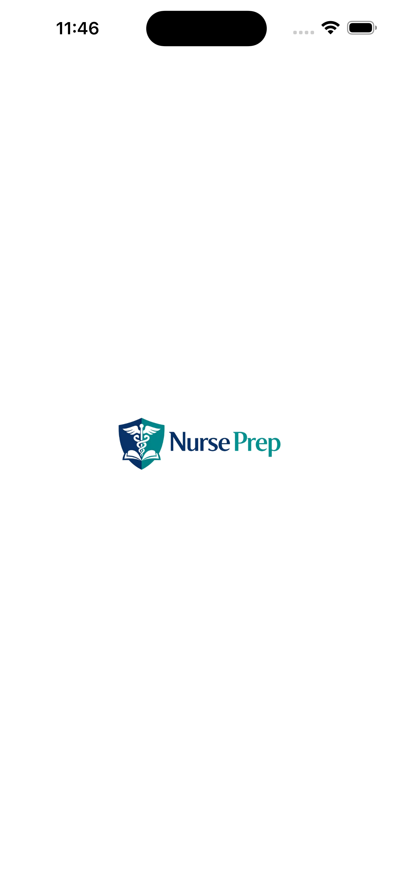
  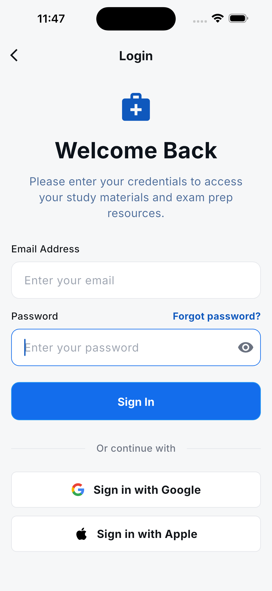
  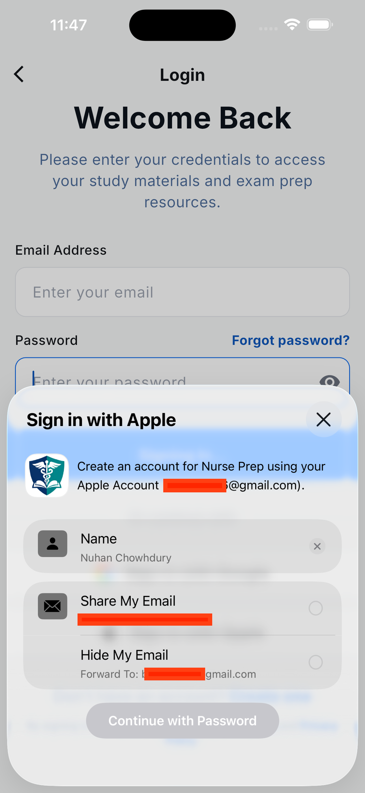
</p>

### Home & Dashboard
<p float="left">
  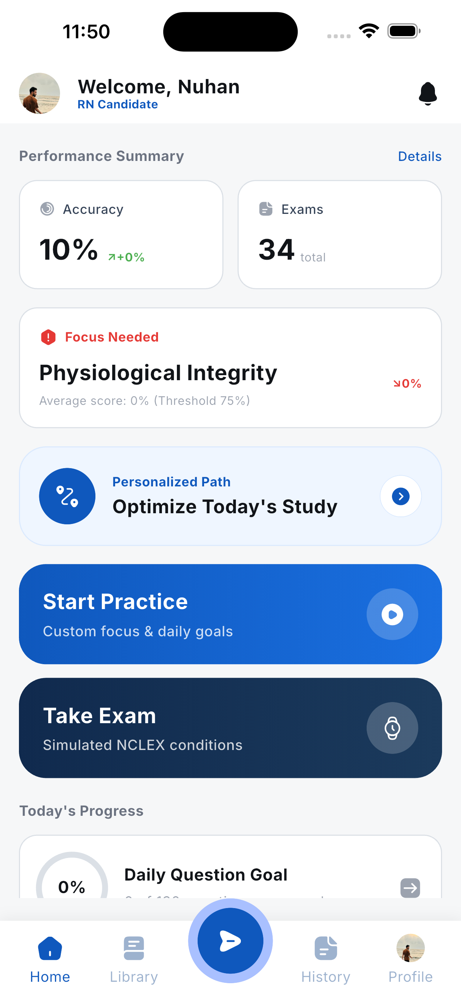
  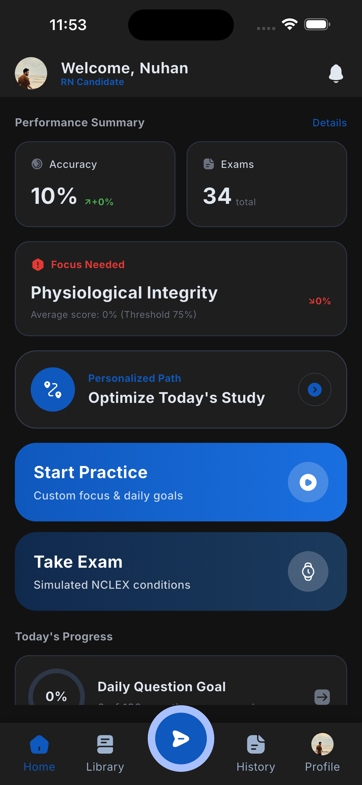
  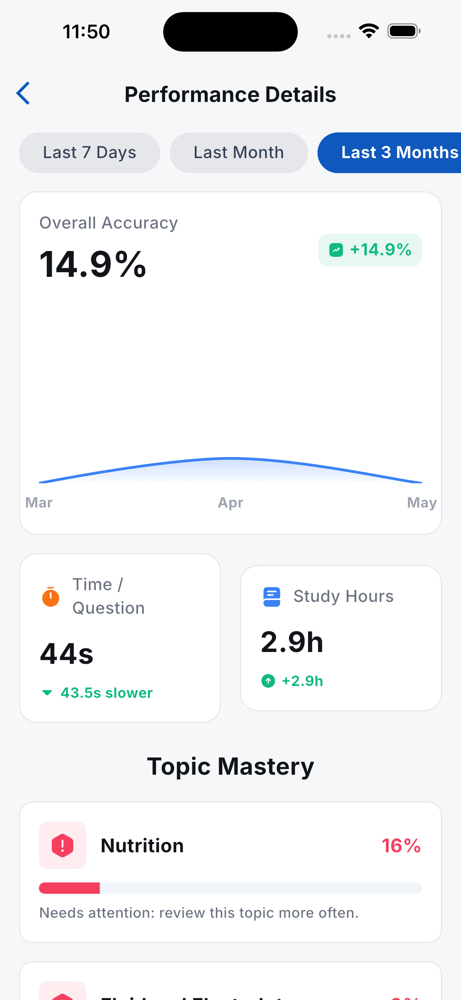
</p>

### Today's Focus & Daily Progress
<p float="left">
  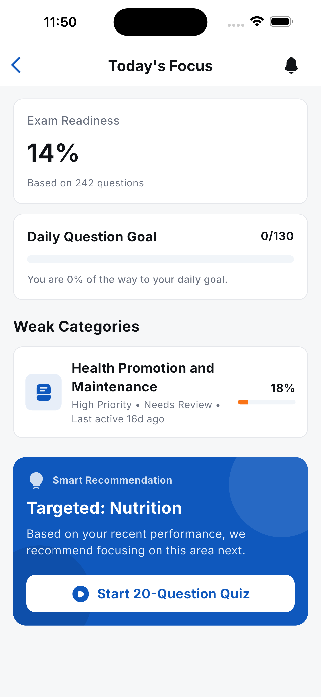
  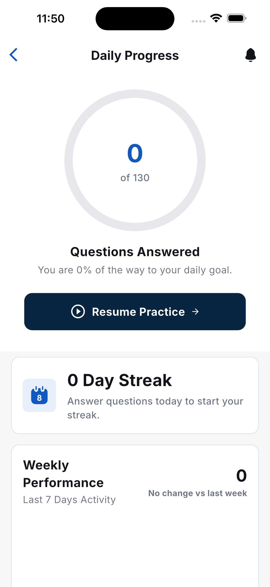
</p>

### Study Library
<p float="left">
  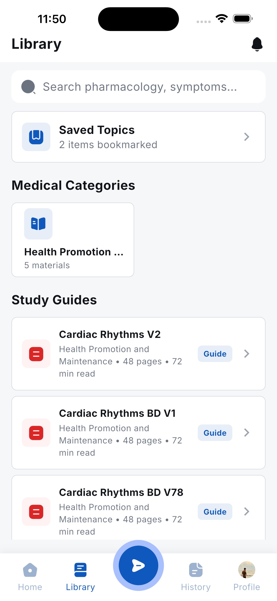
  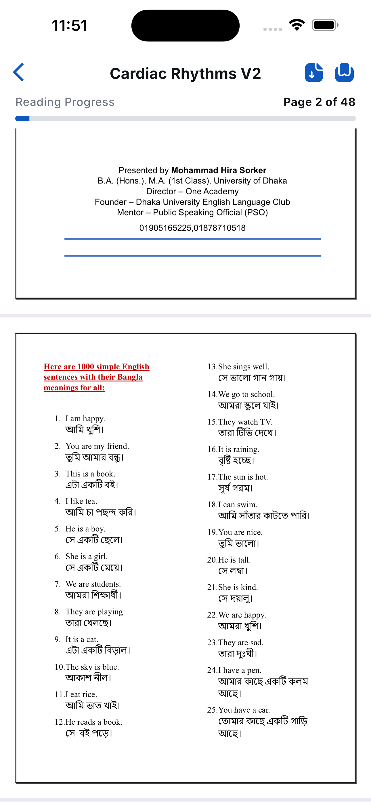
</p>

### Practice & Exam
<p float="left">
  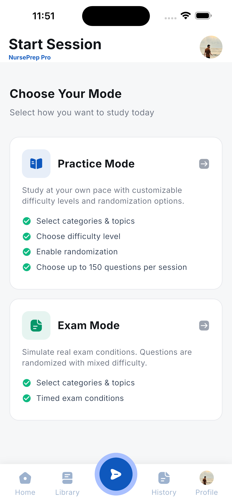
  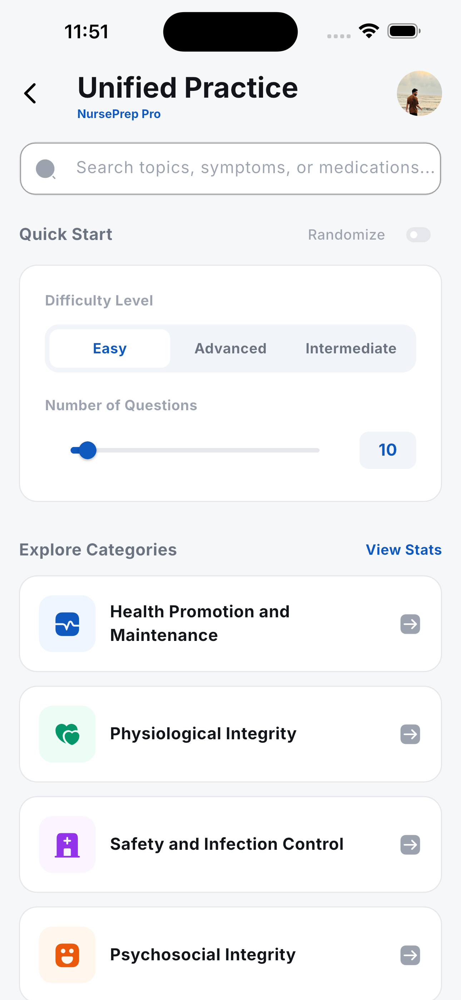
  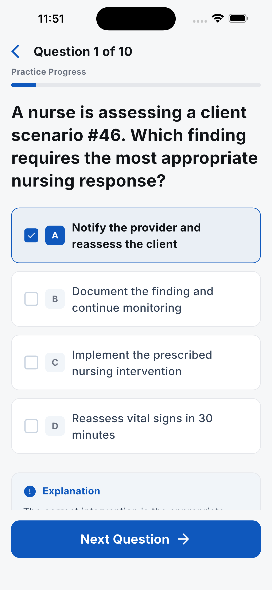
  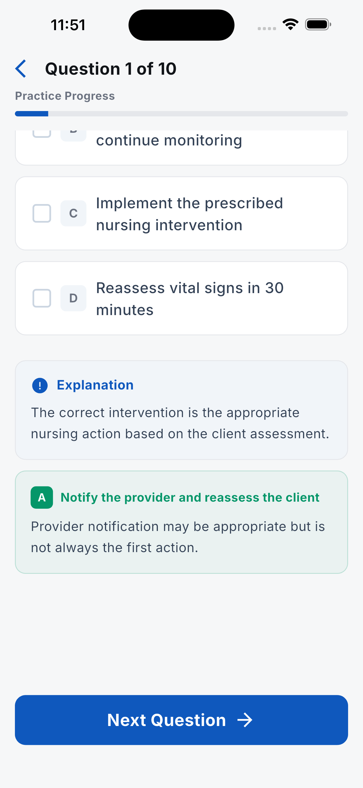
</p>

### Reports & Analytics
<p float="left">
  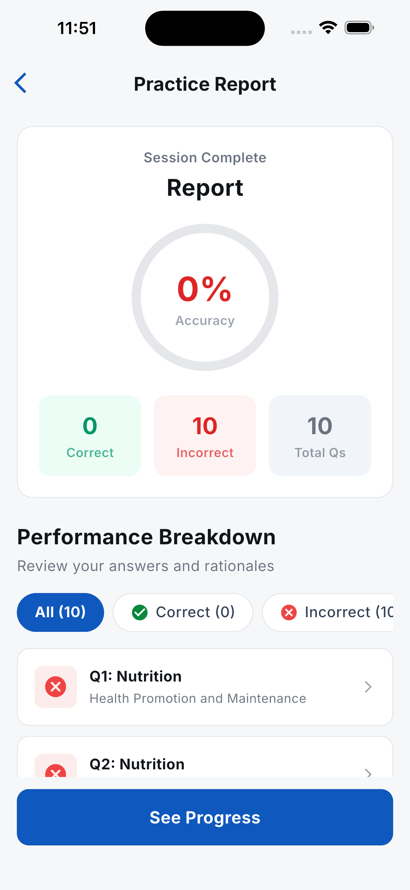
  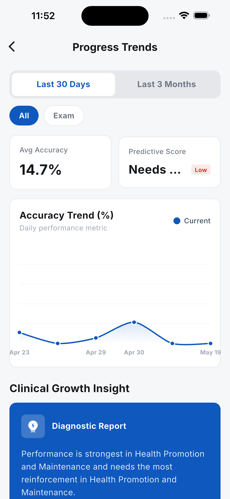
  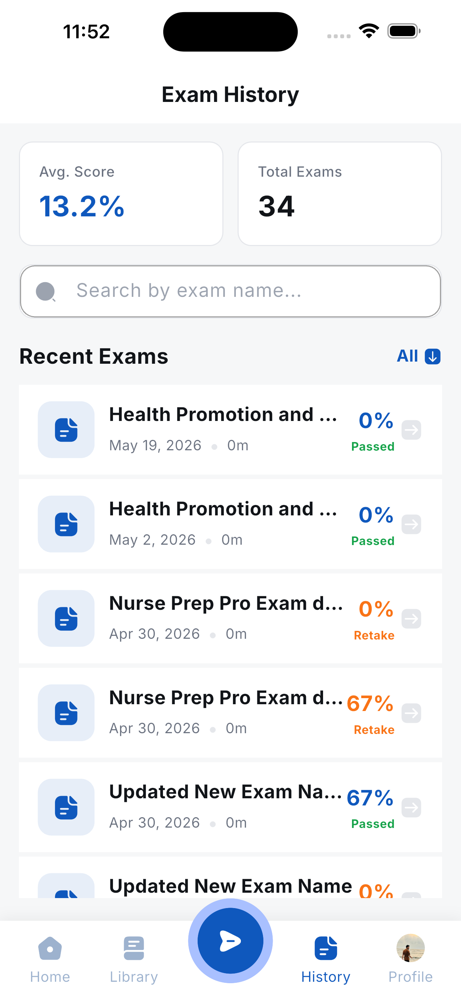
</p>

### Profile & Subscription
<p float="left">
  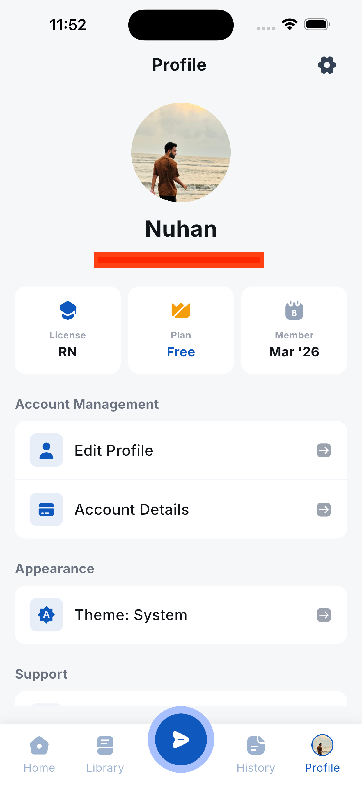
  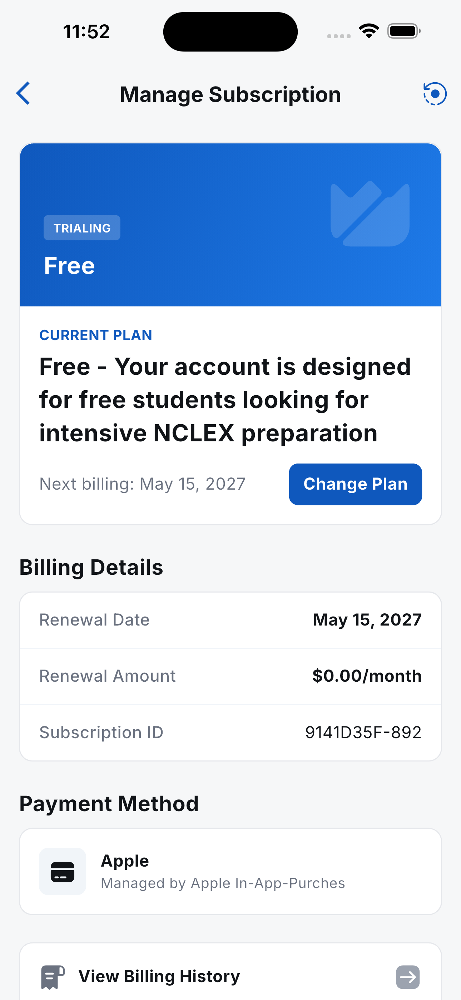
  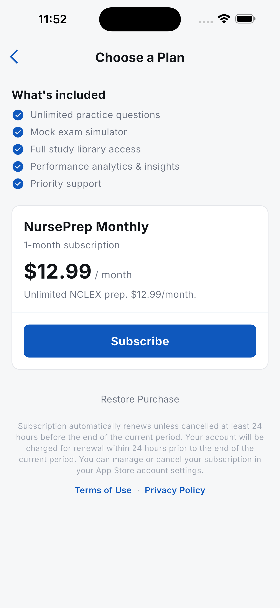
</p>

---

## Features

- **Practice Questions** — Unlimited questions covering all major nursing topics with detailed explanations
- **Mock Exams** — Full-length timed exams that simulate real NCLEX conditions
- **Study Library** — Comprehensive PDF-based study materials organized by topic
- **Today's Focus** — AI-driven daily study sessions targeting your weak areas
- **Performance Analytics** — Track accuracy, study hours, and topic mastery with charts
- **Daily Progress Tracking** — Streaks, question goals, and weekly performance overview
- **Dark & Light Mode** — System-aware theme switching
- **Subscriptions** — Premium content unlocked via RevenueCat in-app purchases
- **Push Notifications** — Daily study reminders via Firebase Messaging
- **Google & Apple Sign-In** — Seamless third-party authentication
- **Exam History** — Full record of past exams with scores and review

---

## Architecture

This project follows a **Feature-First Clean Architecture** pattern:

```
lib/
├── core/                    # Shared layer
│   ├── services/            # Storage, notifications, API client
│   ├── utils/               # Constants, helpers, extensions
│   └── widgets/             # Reusable UI components
├── features/                # Feature modules (self-contained)
│   ├── auth/                # Login, registration, password reset
│   ├── onboarding/          # First-time user setup
│   ├── splash/              # Splash & welcome screens
│   ├── home/                # Home dashboard
│   ├── practice/            # Practice question engine
│   ├── exam_history/        # Past exam records
│   ├── exam_report/         # Detailed exam results
│   ├── library/             # PDF study library
│   ├── subscription/        # Plans & in-app purchases
│   ├── notifications/       # Notification center
│   ├── profile/             # User profile & settings
│   ├── daily_progress/      # Daily study tracking
│   ├── todays_focus/        # Daily curated content
│   ├── performance_details/ # Analytics detail view
│   ├── progress_trend/      # Progress charts & trends
│   └── main_nav/            # Bottom navigation shell
├── app.dart
└── main.dart
```

Each feature module is independently structured with its own controllers, views, and bindings — keeping the codebase scalable and maintainable.

---

## Tech Stack

| Layer | Technology |
|---|---|
| Framework | Flutter |
| State Management | GetX |
| Backend / Auth | Firebase (Auth, Firestore, Messaging) |
| Subscriptions | RevenueCat (`purchases_flutter`) |
| Authentication | Google Sign-In, Sign in with Apple |
| Backend API | NestJS |
| HTTP Client | http |
| PDF Viewer | Syncfusion Flutter PDF Viewer |
| Charts | FL Chart |
| Fonts | Google Fonts |
| Notifications | Flutter Local Notifications, Firebase Messaging |
| Environment Config | flutter_dotenv |
| UI Utilities | Flutter ScreenUtil, Flutter SVG, Iconsax |
| Local Storage | Shared Preferences |

---

## Getting Started

### Prerequisites

- Flutter SDK `>=3.0.0`
- Dart SDK `>=3.0.0`
- Xcode (for iOS builds)
- Android Studio (for Android builds)
- Firebase project configured for both platforms
- RevenueCat account

### Installation

1. **Clone the repository**
   ```bash
   git clone https://github.com/nuhanchowdhurylinkdin-a11y/NursesPrep-Mobile-App.git
   cd NursesPrep-Mobile-App
   ```

2. **Install dependencies**
   ```bash
   flutter pub get
   ```

3. **Create the `.env` file** in the project root:
   ```env
   BASE_URL=your_api_base_url
   GOOGLE_SERVER_CLIENT_ID=your_google_client_id
   REVENUECAT_ANDROID_KEY=goog_xxxxxxxxxxxxxxxxxxxx
   REVENUECAT_IOS_KEY=appl_xxxxxxxxxxxxxxxxxxxx
   ```

4. **Configure Firebase**
   - Create a Firebase project at [console.firebase.google.com](https://console.firebase.google.com)
   - Download `google-services.json` and place it in `android/app/`
   - Download `GoogleService-Info.plist` and place it in `ios/Runner/`
   > These files are excluded from version control for security. Never commit them to a public repo.

5. **Run the app**
   ```bash
   flutter run
   ```

> Make sure `.env` is listed in your `.gitignore` — never commit secrets to version control.

---

## Build & Release

### iOS
```bash
flutter clean
flutter pub get
flutter build ios --release
```
Then archive and distribute via Xcode → Product → Archive → Distribute App.

### Android
```bash
flutter clean
flutter pub get
flutter build appbundle --release
```
Upload the `.aab` file to Google Play Console.

---

## Environment Variables

| Key | Description |
|---|---|
| `BASE_URL` | Base URL for the backend API |
| `GOOGLE_SERVER_CLIENT_ID` | Google OAuth server client ID |
| `REVENUECAT_ANDROID_KEY` | RevenueCat API key for Android (Play Store) |
| `REVENUECAT_IOS_KEY` | RevenueCat API key for iOS (App Store) |

> The `.env` file is declared as a Flutter asset in `pubspec.yaml` and loaded at app startup via `flutter_dotenv`. Never commit it to version control.

---

## Documentation

| Document | Description |
|---|---|
| [NOTIFICATIONS.md](lib/core/services/notifications/NOTIFICATIONS.md) | Notification system architecture, FCM setup, routing, and payload format |

---

## Platform Support

| Platform | Supported | Min Version |
|---|---|---|
| iOS | ✅ | iOS 15.0+ |
| Android | ✅ | Android 5.0+ (API 21+) |

---

## Developer

Fully designed and developed by **MD Ali Nuhan Chowdhury**
- Email: nuhanchowdhurylinkdin@gmail.com
- Website: [www.nursesprep.com](https://www.nursesprep.com)
- GitHub: [github.com/nuhanchowdhurylinkdin-a11y](https://github.com/nuhanchowdhurylinkdin-a11y)
- LinkedIn: [linkedin.com/in/nuhanchowdhury](http://www.linkedin.com/in/nuhanchowdhury)

---

## License

Copyright © 2026 NursesPrep LLC. All rights reserved.
